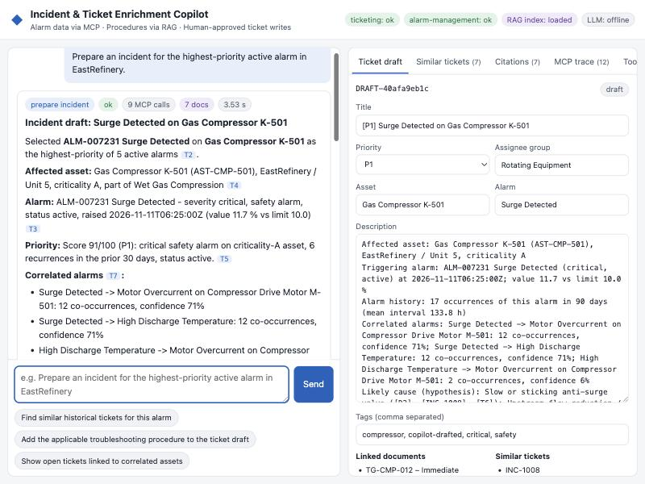

# Incident & Ticket Enrichment Copilot

[](https://github.com/Abhishekkakade1998/Incident-and-Ticket-Enrichment/actions/workflows/ci.yml)

An operator-facing copilot that investigates alarms, gathers supporting evidence, and prepares an incident ticket for human review. Alarm and ticket data are accessed through two Model Context Protocol (MCP) servers; operating procedures and troubleshooting guidance are retrieved from a local document RAG index.



> **Demo project:** This repository uses synthetic alarm data and a mock ticketing system. It is an engineering demonstration, not a production system and not intended to control equipment.

## What it does

- Accepts natural-language requests and maintains context across follow-up questions.
- Discovers and invokes tools from the alarm-management and ticketing MCP servers.
- Builds multi-step workflows using asset metadata, alarm history, priority scoring, recommendations, correlations, and ticket records.
- Retrieves relevant procedures and historical resolution notes using hybrid BM25 and vector search, with metadata filters and citations.
- Produces answers with references to tool results (`[T#]`), document chunks (`[D#]`), and tickets (`[INC-#]`).
- Creates an editable ticket draft. **Creating or commenting on a ticket requires explicit human approval**; the approval token is bound to the draft payload and expires.
- Shows MCP calls, retrievals, citations, warnings, and partial failures in the UI.

## Screenshots

- [Incident draft](docs/screenshots/01-incident-draft.jpg)
- [MCP execution trace](docs/screenshots/02-mcp-trace.jpg)
- [Citations and approved ticket](docs/screenshots/03-citations-and-approved-ticket.jpg)
- [MCP tool discovery](docs/screenshots/04-mcp-tool-discovery.jpg)
- [Degraded / partial-failure handling](docs/screenshots/05-degraded-partial-failure.jpg)

## Architecture

```text
Browser UI
   │
   ▼
Copilot API and orchestrator ─────► RAG retriever ◄──── Documents and index
   │
   ├──► Alarm Management MCP ─────► Alarm API simulator
   └──► Ticketing MCP ────────────► Mock ticketing API
          (writes require approval)
```

See the [architecture diagram](docs/architecture-diagram.png) and [architecture notes](docs/architecture.md).

| Component | Purpose |
|---|---|
| `apps/backend/copilot/` | FastAPI service, intent handling, orchestration, evidence composition, MCP client, audit, and optional LLM provider |
| `apps/frontend/` | Browser chat, ticket-draft editor, citations, MCP trace, tool catalog, and audit views |
| `mcp-servers/alarm-management/` | Read-only alarm and asset tools |
| `mcp-servers/ticketing/` | Ticket lookup tools and approval-gated write tools |
| `simulators/` | Synthetic Alarm Management API and mock ticketing API |
| `rag/` | Document ingestion, retrieval, sample corpus, and tests |
| `connectors/`, `common/` | HTTP retries, tracing, logging, approval helpers, and shared utilities |
| `tests/` | Unit, integration, and end-to-end tests |

## Quick start with Docker Compose

### Requirements

- Docker Desktop or Docker Engine with the Compose plugin.

### Start the application

From the repository root, copy the example environment file and set local placeholder values for the API, MCP, and approval secrets. Do not use production credentials for this demo.

**PowerShell**

```powershell
Copy-Item .env.example .env
```

**macOS / Linux / WSL**

```bash
cp .env.example .env
```

Then start the stack:

```bash
docker compose up --build
```

Open the UI at [http://localhost:8080](http://localhost:8080). The API readiness endpoint is [http://localhost:8081/ready](http://localhost:8081/ready).

| Service | Local address |
|---|---|
| Web UI | `http://localhost:8080` |
| Copilot API | `http://localhost:8081` |
| Alarm API simulator | `http://localhost:8000` |
| Ticketing API simulator | `http://localhost:8100` |
| Alarm Management MCP | `http://localhost:9001/mcp` |
| Ticketing MCP | `http://localhost:9002/mcp` |

Stop the stack with `Ctrl+C`, or run `docker compose down` in another terminal.

The default `LLM_PROVIDER=offline` uses a deterministic local composer and makes no LLM API calls. To enable the optional Anthropic provider, set `LLM_PROVIDER=anthropic` and provide `LLM_API_KEY` in your local `.env`. Never commit `.env`.

## Local development (Linux, macOS, or WSL)

The local runner uses Bash, GNU Make, and a POSIX-style virtual environment. For native Windows, Docker Compose is the simpler option.

1. Copy `.env.example` to `.env`.
2. For the local runner, change the API URLs in `.env` from Docker service names to localhost:

   ```dotenv
   ALARM_API_BASE_URL=http://127.0.0.1:8000
   TICKETING_API_URL=http://127.0.0.1:8100
   ALARM_MCP_URL=http://127.0.0.1:9001/mcp
   TICKETING_MCP_URL=http://127.0.0.1:9002/mcp
   ```

3. Create the environment, install development dependencies, and start the services:

   ```bash
   make install
   make run
   ```

The UI is served at [http://127.0.0.1:8080](http://127.0.0.1:8080). `make run` starts the API simulators, both MCP servers, ingests the RAG corpus, and starts the copilot backend.

## Example requests

- “Prepare an incident for the highest-priority active alarm in EastRefinery.”
- “Find similar historical tickets for this compressor alarm.”
- “Add the applicable troubleshooting procedure to the ticket draft.”
- “Show open tickets linked to correlated assets.”
- “Investigate recurring high-severity alarms for Boiler Feed Pump 101 over the last 90 days.”

The incident workflow produces a draft; it does not create a ticket until an operator reviews and approves it in the UI.

## MCP tools and RAG

The alarm-management MCP server exposes 14 read-only tools for assets, alarms, trends, correlations, priorities, recommendations, and KPIs. The ticketing MCP server exposes ticket search and lookup tools plus approval-gated `create_ticket` and `add_ticket_comment` tools.

The RAG pipeline ingests Markdown, text, HTML, and JSON documents. It sanitizes instruction-like content, creates heading-aware chunks, and builds a local JSON index with deterministic hashing embeddings. Retrieval combines BM25 and vector similarity, applies metadata filters, and returns citations. The index is generated at ingestion/startup and is not required as a committed artifact.

See the [MCP tool catalog](docs/mcp-tool-catalog.md), [RAG design](docs/rag-design.md), [example retrievals](test-data/example_retrievals.json), and [API integration notes](docs/api-integration.md).

## Tests and quality checks

Python 3.11 or newer is required for local development. After installing dependencies with `make install`, use:

| Command | Description |
|---|---|
| `make test` | Run the full test suite |
| `make test-unit` | Run unit tests |
| `make test-mcp` | Run MCP server and client tests |
| `make test-rag` | Run RAG ingestion and retrieval tests |
| `make test-e2e` | Run end-to-end tests against services on real ports |
| `make coverage` | Run tests with coverage reports |
| `make lint` | Run Ruff lint and format checks |
| `make typecheck` | Run mypy |
| `make audit` | Audit runtime dependencies with pip-audit |

GitHub Actions also checks formatting, types, test suites, coverage, dependencies, secrets, and the Docker Compose build.

## Configuration

Configuration is read from environment variables and `.env`; see [`.env.example`](.env.example) for the complete list.

| Variables | Purpose |
|---|---|
| `ALARM_API_*`, `TICKETING_API_*` | Simulator/source API addresses and credentials; used by the MCP servers |
| `ALARM_MCP_*`, `TICKETING_MCP_*` | Copilot-to-MCP server addresses and bearer tokens |
| `APPROVAL_SIGNING_KEY`, `APPROVAL_TTL_S` | Signing key and lifetime for approval tokens |
| `SOURCE_TIMEOUT_S`, `SOURCE_MAX_RETRIES`, `TOOL_TIMEOUT_S`, `MCP_TOOL_TIMEOUT_S` | Source and MCP request timeouts/retries |
| `DOCUMENT_PATH`, `RAG_INDEX_PATH`, `RAG_AUTO_INGEST`, `RAG_TOP_K` | RAG corpus, generated index, ingestion, and retrieval settings |
| `LLM_PROVIDER`, `LLM_API_KEY`, `LLM_MODEL` | Offline or optional Anthropic provider configuration |
| `SIM_ANCHOR_TIME` | Fixed simulator time for repeatable scenarios |

## Security and project limitations

- Source-system credentials belong to the MCP servers; the copilot calls those servers rather than source APIs directly.
- MCP endpoints use bearer authentication. Ticket writes require an expiring, payload-bound approval token and an idempotency key.
- Retrieved documents are treated as untrusted input. The system filters/sanitizes content and validates citations from optional LLM output.
- The alarm data and ticketing API are simulated. The project does not include production SSO, durable conversation state, PDF/DOCX ingestion, or neural embeddings.
- This demo is not a substitute for operator procedures, safety systems, or production access controls.

More detail is in [known limitations](docs/known-limitations.md), [design decisions](docs/design-decisions.md), and [how the project was built](docs/how-it-was-built.md).

## Contributors

- [Abhishekkakade1998](https://github.com/Abhishekkakade1998) - Project owner and developer.
- [GitHub Copilot](https://github.com/features/copilot) - AI coding assistant.
