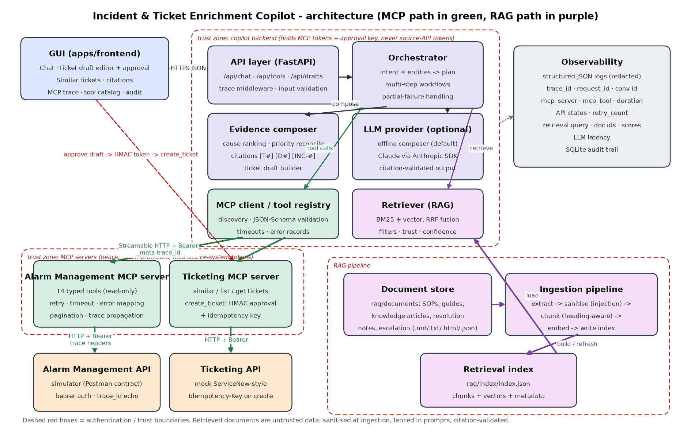

# Architecture



## Components and boundaries

| Layer | Code | Responsibility |
|---|---|---|
| GUI | `apps/frontend/` | Chat, editable ticket draft, approval dialog, similar tickets, citations, MCP trace, tool catalog, audit trail. No build step; served by the backend locally or by nginx in Docker. |
| API layer | `apps/backend/copilot/api.py` | HTTP API, input validation, trace middleware, security headers, health/readiness. |
| Orchestration | `apps/backend/copilot/orchestrator.py`, `intent.py` | Intent detection + entity extraction -> per-intent workflow -> chain MCP tools and RAG -> response. Context retention per conversation. |
| Evidence composer | `apps/backend/copilot/compose.py` | Fuse tool data, tickets and documents into cited sections; rank causes by agreeing sources; reconcile priority; build ticket drafts; validate LLM citations. |
| LLM provider | `apps/backend/copilot/llm.py` | Replaceable: `offline` (deterministic composer, default) or `anthropic` (Claude via the official SDK). Output accepted only if every citation is valid. |
| MCP client / tool registry | `apps/backend/copilot/mcp_client.py` | Discovery across servers, JSON-Schema validation of arguments, invocation with `_meta` trace, uniform `ToolCallRecord` for every outcome. |
| MCP servers | `mcp-servers/alarm-management/`, `mcp-servers/ticketing/` | Typed tools over the source systems. Own the source-system credentials. Retry, timeout, error mapping, pagination, trace propagation, write approval. |
| Connectors | `connectors/` | Reusable async HTTP clients (`JsonHttpClient`) with auth, trace headers, retries, error taxonomy and call telemetry. |
| Source systems | `simulators/` | Alarm Management API simulator (Postman contract) and mock ticketing API. |
| RAG ingestion | `rag/ingestion/` | Extract (.md/.txt/.html/.json) -> sanitise -> chunk -> embed -> index (incremental). |
| Retrieval | `rag/retrieval/`, `rag/index_store.py` | Hybrid BM25 + dense retrieval, filters, trust boundary, confidence. |
| Domain models | `rag/models.py`, `alarm_mcp/models.py`, `copilot/state.py` | Typed contracts between layers. |
| Auth / config | `*/config.py`, `*Settings`, `common/approval.py`, `common/mcp_support.py` | Env-based configuration, bearer auth, approval tokens. |
| Observability | `common/logging.py`, `common/tracing.py`, `copilot/audit.py` | JSON logs with redaction, trace context, SQLite audit trail. |
| Persistence | `copilot/audit.py`, `copilot/state.py`, `rag/index/` | Audit events (SQLite), conversations + drafts (in-memory, bounded), RAG index (JSON file). |

## Authentication boundaries

```
GUI --(same-origin HTTPS; operator identity in x-user)--> Copilot backend
Copilot backend --(Bearer ALARM_MCP_TOKEN / TICKETING_MCP_TOKEN)--> MCP servers
MCP servers --(Bearer ALARM_API_TOKEN / TICKETING_API_TOKEN)--> source APIs
Copilot backend --(HMAC approval token, APPROVAL_SIGNING_KEY)--> ticketing MCP create_ticket
```

* The backend never holds source-system tokens; the MCP servers never see GUI sessions.
* A write needs a token that only the backend's `/api/drafts/{id}/approve` endpoint mints, and only after `confirm: true` from a named human. The token is bound to the exact payload (SHA-256 of canonical JSON) and expires (10 min). The ticketing MCP server verifies it independently, so neither the planner, an LLM, nor a prompt-injected document can create a ticket.

## Request flow: prompt to grounded answer

Example: *"Investigate recurring high-severity alarms for Boiler Feed Pump 101 over the last 90 days ..."*

1. **GUI** posts `{message, conversation_id}` to `/api/chat`. The trace middleware creates (or adopts the incoming) `trace_id` / `request_id` and puts it in a `ContextVar`.
2. **Intent detection** (`intent.classify`) scores rule sets and extracts entities: `asset_ref="Boiler Feed Pump 101"`, `asset_type=pump`, `lookback_days=90`, `severity=[high, critical]`. The plan is recorded as the first trace step.
3. **Asset resolution via MCP:** `search_assets(query="Boiler Feed Pump 101")` -> `AST-BFP-101` -> `get_asset_metadata(asset_id)`. Weak matches trigger a clarification question rather than a guess.
4. **Parallel MCP analytics** (each depends on the asset id from step 3): `get_alarm_summary` (group by alarm name; count, recurrence rate, ack delay), `get_alarm_trends` (weekly), `correlate_alarms` (co-occurrence incl. other assets in the unit).
5. **Chained follow-up:** the top recurring alarm name from the summary feeds `list_alarms(asset_id, alarm_name, page_size=1)` to get the latest activation; its `alarm_id` feeds `get_operator_recommendations` and `score_alarm_priority`.
6. **Ticket context via the second MCP server:** `search_similar_tickets` (query built from alarm + asset + likely causes) and `list_tickets` for the asset plus correlated / connected assets.
7. **RAG in the same workflow:** query built from the alarm names, asset type and the recommendation's `procedure_keywords`; filters `asset_type=pump` (strict), `alarm_names`, `sites`. A second retrieval fetches the escalation rules (ESC-001) to apply priority policy.
8. **Evidence fusion:** causes are mined from recommendations, similar-ticket resolutions and document chunks, then ranked by the number of independent sources that agree. Priority from the alarm system is reconciled with ESC-001 rules; disagreement is surfaced as a conflict note and the more urgent band is used.
9. **Composition:** the offline composer renders cited Markdown (`[T#]` tool calls, `[D#]` chunks, `[INC-#]` tickets). If an LLM provider is configured, it writes the narrative from the same evidence bundle; the answer is used only when every citation marker exists in the bundle.
10. **Response** carries: answer, structured sections, citations, full trace (plan, every MCP call with arguments / status / duration / retries / API status codes / dependency ids, every retrieval with hits and scores), ticket draft (for incident intents), similar and linked tickets, warnings and follow-up suggestions. Every step is written to the audit log.
11. **Approval (separate request):** the operator edits the draft, confirms in a modal with their name -> backend mints the approval token -> `create_ticket` via the ticketing MCP server with `idempotency_key=draft_id` -> ticket id returned and audited.

## Failure handling

| Failure | Where handled | User-visible result |
|---|---|---|
| Transient source error (5xx/429/timeout) | `connectors.http` retries with backoff | Success; retry count shown in trace |
| Retries exhausted / source down | MCP server maps to `upstream_unavailable` | Step marked failed; response `partial` (optional step) or `error` (required step) |
| MCP server unreachable | `ToolRegistry.call` -> `unavailable` | Same as above; `/ready` reports `degraded` |
| Tool missing | registry re-discovers once, then `tool_not_found` | Warning; workflow continues where possible |
| Invalid arguments | client-side JSON-Schema validation, then server Pydantic validation | `invalid_arguments` record, no call made |
| Low retrieval confidence | retriever `confidence` | "Documentation coverage is low" note / refusal to guess |
| Ambiguous or unknown asset | `resolve_asset` | Clarification question |
| LLM error or ungrounded output | `_finalise` | Template answer + warning |
| Ticket write rejected | ticketing MCP `approval_required` | Draft marked `failed`, kept for retry |
